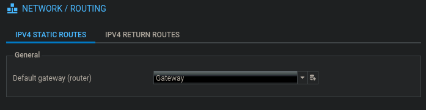
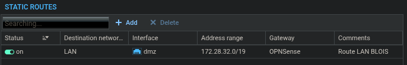
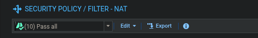
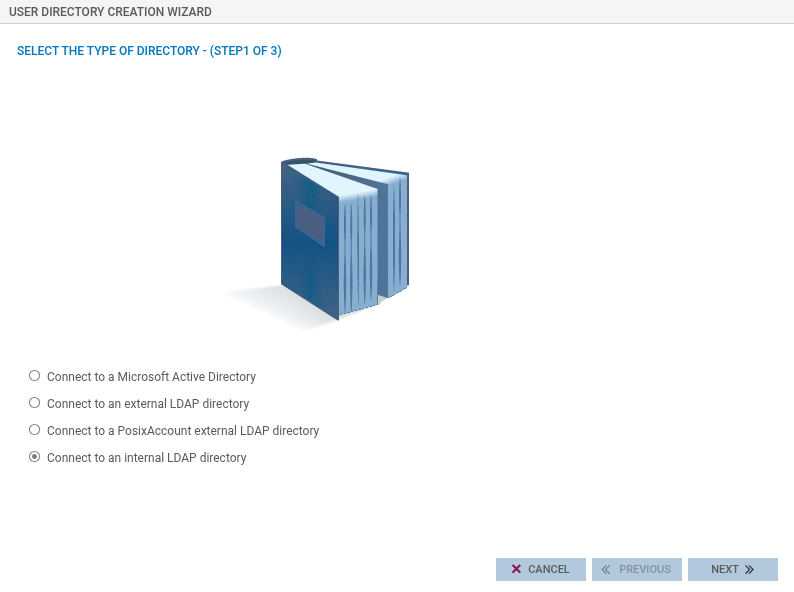
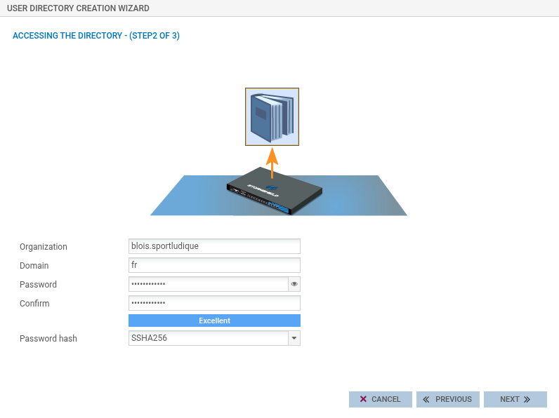
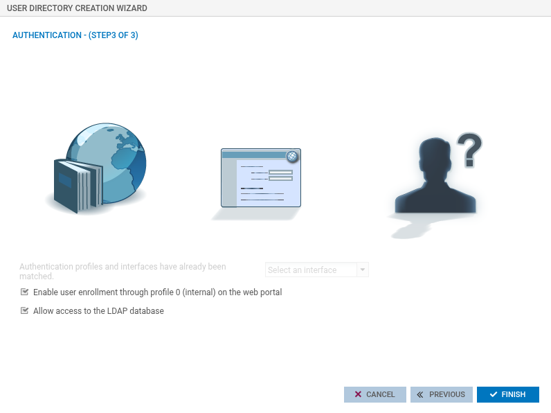
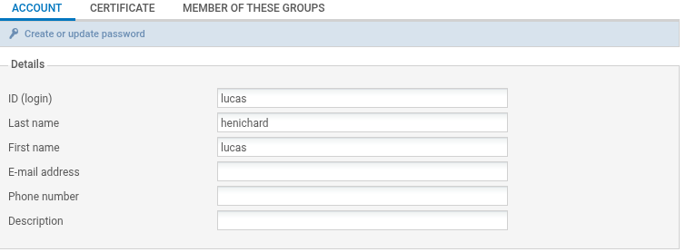
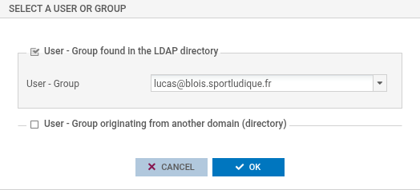

# StormShield

## Routage

### Objets nécessaires

Configuration > Objects  

#### Networks
Réseau MANA et LAN  
Add > Network > les ip des réseaux

#### Hosts
Gateway out (vers internet) et gateway in (vers la LAN)  
Add > Host > les ip des hosts

### Routes 
Il faut définir les routes vers internet (default) et vers la LAN

#### Route par défaut

Dans Configuration > Routing  


#### Route vers la LAN


## Filtrage
Configuration > Security Policy > Filter - NAT  

### Pass All  
Pour les tests, on désactive le filtrage, on mets le Pass All:  



## Création d'utilisateurs
On peut créer des users attitrés, ils n'auront par contre pas autant de permissions que admin  

### Création d'un répertoire LDAP
Dans Configuration > USERS > Directories configuration:  





### Création de l'utilisateur
Dans CONFIGURATION > USERS > Users and Groups:  
Cliquer sur Add user  



### Ajouter les perms admins

Dans CONFIGURATIONS > SYSTEM > Administrators:  
Add an administrator with all privileges  



### NAT

- Se rendre sur l'interface Web du StormShield puis dans "Security Policy / Filter-NAT"  
- Dans la partie "NAT" Ajouter une règle:  
```
Original Traffic
Source: DMZnet, LAN
Destination: Any
Dest. Port: Any

Traffic After Translation
Source: Firewall_out

Laisser tout le reste vide
```

### Port Forwarding

- Se rendre sur l'interface Web du StormShield puis dans "Security Policy / Filter-NAT"  
- Dans la partie "NAT" Ajouter une règle:  
```
Original Traffic
Source: Any, Interface: out
Destination: Any
Dest. Port: dns,dns_udp,dns_tcp

Traffic After Translation
Destination: DNSAUT (DNS d'autorité)

Laisser tout le reste vide
```
